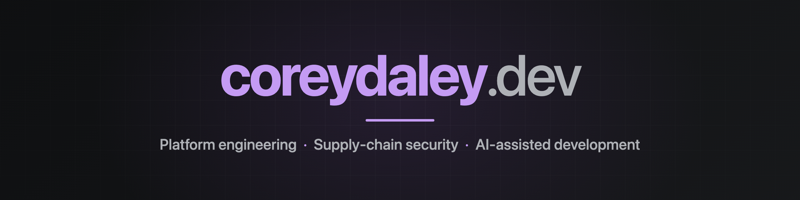

# Hi, I'm Corey Daley

Staff Software Engineer at [Chainguard](https://www.chainguard.dev), working on cloud-native infrastructure and supply-chain security. 20+ years building platforms, including a decade-plus on OpenShift. These days I lead AI agents to ship real software, and I write about what that actually takes.

## What I work on

- **Platforms:** containers, Kubernetes, and the messy parts of running them at scale
- **Supply-chain security:** signing, attestation, SBOMs, the whole pipeline
- **Agentic development:** review pipelines, multi-agent planning, and the guardrails that keep them honest
- **Small apps for Apple platforms:** local-first, no ads, no tracking, no sign-ups

## Apps

| | |
| --- | --- |
| [**Purrchiver**](https://coreydaley.dev/apps/purrchiver/) | The clean Mac archive utility: open, create, and edit RAR, Zip, 7z and more, including encrypted archives. Sandboxed, no ads, no subscription. On the Mac App Store. |
| [**Secret Store**](https://coreydaley.dev/apps/secretstore/) | Small secrets (recovery codes, license keys, that one Wi-Fi password) in Apple's end-to-end encrypted iCloud Keychain. No vendor crypto, no account, no server. macOS + iOS. |

## Open source

| | |
| --- | --- |
| [**MessagePit**](https://github.com/coreydaley/messagepit) | Email and SMS testing for developers: a Mailpit fork with a Twilio-compatible SMS endpoint, a SendGrid stub, and webhook capture. |
| [**agent-config**](https://github.com/coreydaley/agent-config) | My Claude Code setup: dot-graph skills, a feature-planning workflow, multi-agent audits, and hooks that keep a public config free of secrets. |

Archived: [Polyphon](https://coreydaley.dev/projects/polyphon/) (multi-model AI chat) and [Attractor](https://coreydaley.dev/projects/attractor/) (DOT-graph AI pipelines).

## Roadmaps

| | |
| --- | --- |
| [**AI Practice Roadmap**](https://github.com/coreydaley/.github/blob/main/AI-Practice-Roadmap.md) | The path I'm on: building with models and around them (evals, agent security, context engineering, orchestration), learned by shipping. |
| [**AI/ML Learning Roadmap**](https://github.com/coreydaley/.github/blob/main/AI-ML-Learning-Roadmap.md) | The path I set aside: a 12-month curriculum for learning how models are trained. Still there if training is what you're after. |

## Latest from the blog

<!-- BLOG-POST-LIST:START -->
- [Designing App Store screenshots that don&#39;t need updating every release](https://coreydaley.dev/posts/2026/11/app-store-screenshots-that-last/)
- [Apple&#39;s on-device model vs Llama 3.2 3B on the same Mac](https://coreydaley.dev/posts/2026/11/apples-on-device-model-vs-llama/)
- [Can a tool teach Apple&#39;s on-device model tic-tac-toe?](https://coreydaley.dev/posts/2026/11/tool-calling-tic-tac-toe/)
- [I mounted a ZIP from a sandboxed Mac app with FSKit, and I&#39;m not shipping it](https://coreydaley.dev/posts/2026/11/mounting-a-zip-with-fskit-and-not-shipping-it/)
- [What Apple&#39;s on-device model is actually good at](https://coreydaley.dev/posts/2026/11/what-apples-on-device-model-is-good-at/)
<!-- BLOG-POST-LIST:END -->

**Stack:** Go · Python · Swift · Kubernetes · OpenShift · Containers · Claude Code

[coreydaley.dev](https://coreydaley.dev) &nbsp;·&nbsp; [LinkedIn](https://www.linkedin.com/in/coreydaley-dev/) &nbsp;·&nbsp; [corey@coreydaley.dev](mailto:corey@coreydaley.dev)

Public keys

- [SSH (ed25519)](https://github.com/coreydaley/.github/raw/main/keys/id_ed25519.pub)
- [SSH (rsa)](https://github.com/coreydaley/.github/raw/main/keys/id_rsa.pub)
- [GPG public key](https://github.com/coreydaley/.github/raw/main/keys/corey.asc)

